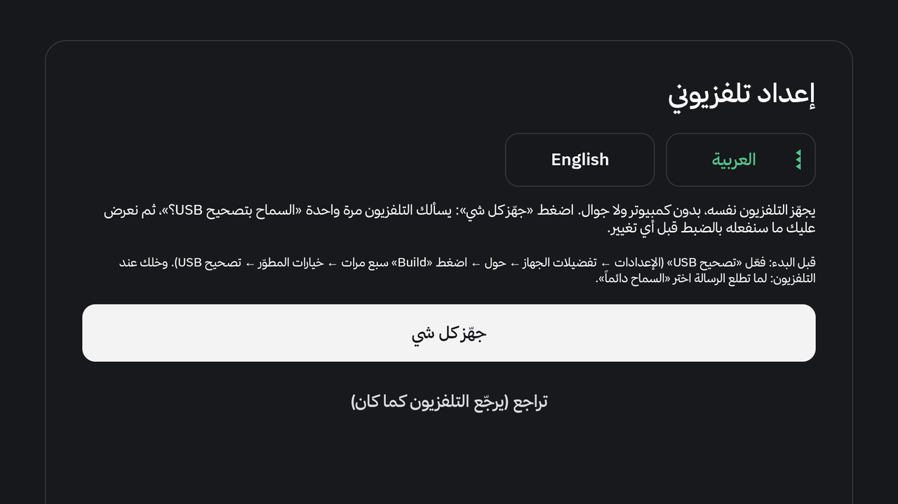
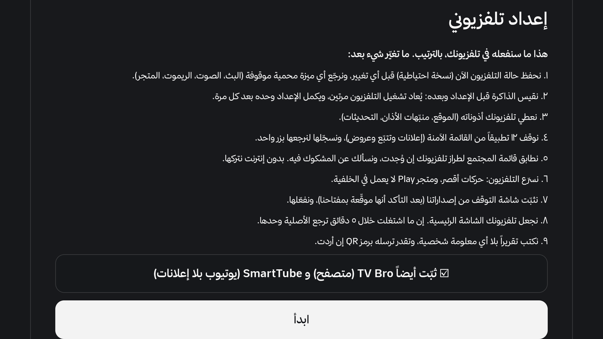
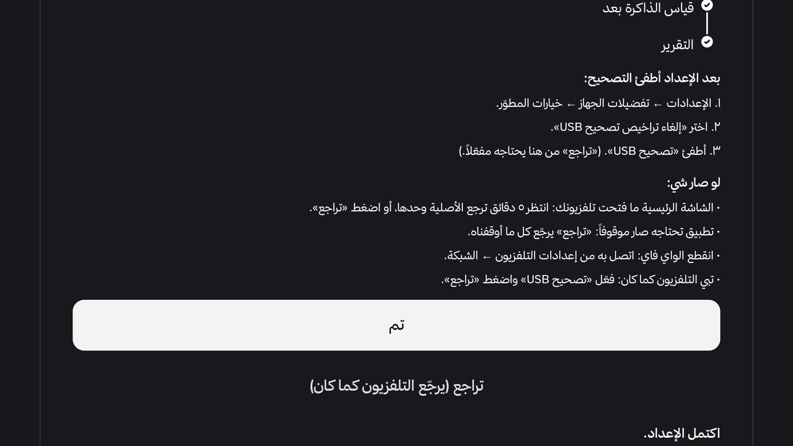
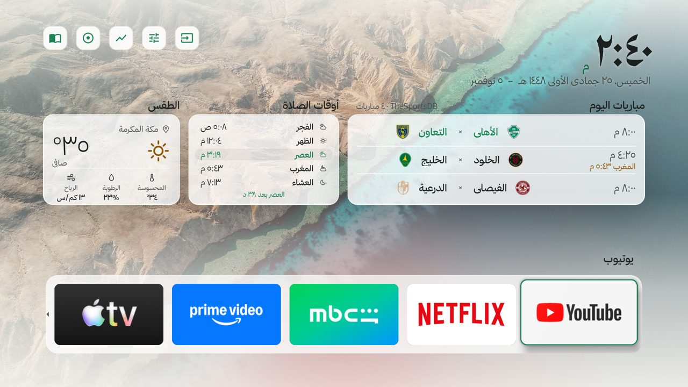
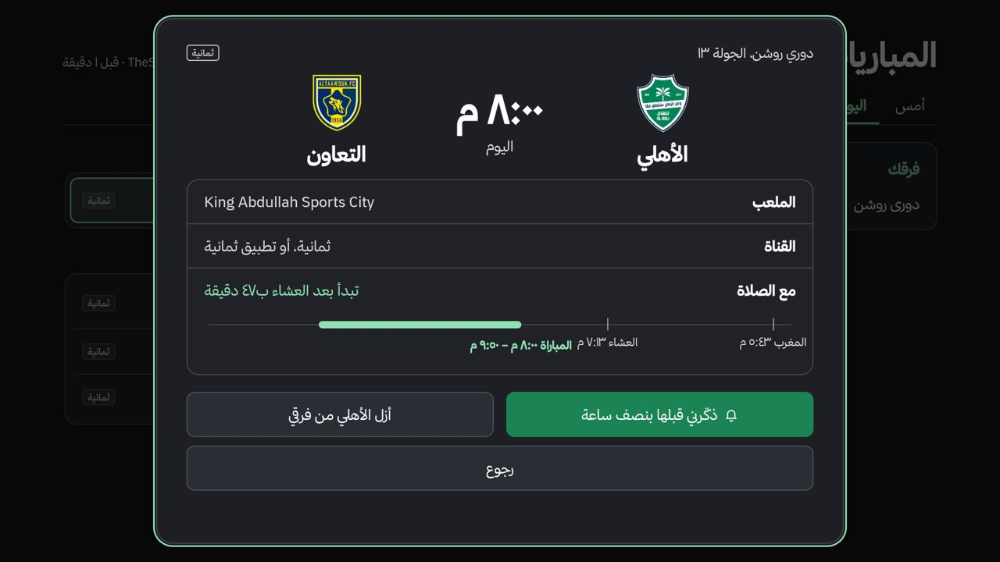
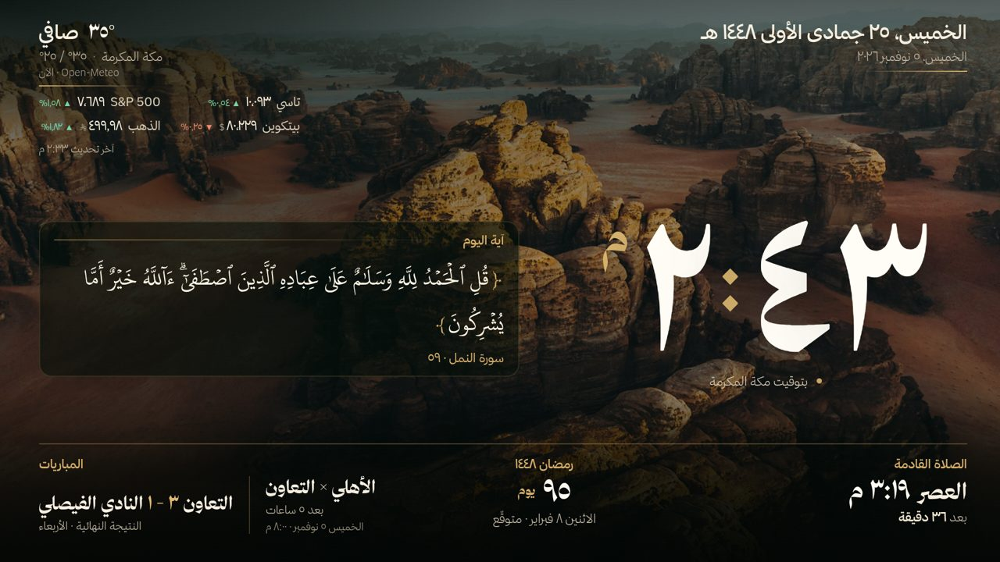

<h1 align="center">تلفزيونك · UrTV</h1>

واجهة رئيسية عربية وشاشة توقف سعودية لتلفزيونات Android TV و Google TV، وتسريع آمن للتلفزيون. تركّبها من التلفزيون نفسه بزر واحد، أو من جوالك أو كمبيوترك.

An Arabic home screen and a Saudi screensaver for Android TV / Google TV, and a safe speed-up. Set it up from the TV itself with one button, or from your phone or computer.

## التثبيت: اختر طريقة

| الطريقة | تحتاج | المدة |
|---|---|---|
| **① التلفزيون وحده** (الأسهل) | التلفزيون والريموت | ١٠–٢٠ دقيقة |
| **② من جوال** أندرويد أو آيفون | جوال على نفس الواي فاي | مثل الكمبيوتر (الآيفون أبطأ) |
| **③ من كمبيوتر** | كمبيوتر على نفس الواي فاي ومساعد ذكي | ٤٠ دقيقة |

> **مهم:** تثبيت التطبيق وحده **ما يخلّيه الشاشة الرئيسية**. اللي يحوّل التلفزيون ويسرّعه هو **الإعداد** («جهّز كل شي» أو الأوامر)، وتقدر ترجع كل شي مثل ما كان بأي وقت.

### ① التلفزيون وحده
1. **فعّل التصحيح:** الإعدادات ← تفضيلات الجهاز ← حول ← اضغط OK على **Build** سبع مرات، ثم **خيارات المطوّر** ← شغّل **تصحيح USB**.
2. **ثبّت تطبيق Downloader** من متجر التلفزيون، واكتب فيه الرمز **9378345** ← **تثبيت** (اسمح له بتثبيت التطبيقات لو سألك).
3. **افتح «إعداد تلفزيوني»** من صف التطبيقات ← اضغط **«جهّز كل شي»**.
4. التلفزيون يسألك «السماح بتصحيح USB؟» ← **السماح دائماً**. تطلع لك الخطة بأرقام تلفزيونك قبل أي تغيير ← **«ابدأ»**، وخلّه يكمل (يعيد التشغيل مرتين ويكمل وحده).

| الشاشة الأولى | الخطة قبل أي تغيير | النهاية |
|---|---|---|
|  |  |  |

### ② من جوال أندرويد أو آيفون
- **التلفزيون:** فعّل التصحيح مثل الخطوة ١ فوق.
- **أندرويد:** ثبّت **Termux** وشغّل نفس أوامر الكمبيوتر من الجوال.
- **آيفون / آيباد:** ثبّت **iSH** (أبطأ).
- الخطوات كاملة: [`docs/PHONE-SETUP.md`](docs/PHONE-SETUP.md).

### ③ من كمبيوتر (مع مساعد ذكي)
1. **التلفزيون:** فعّل التصحيح مثل الخطوة ١ فوق.
2. **الكمبيوتر**، على نفس الواي فاي، وعليه واحد من هذي:

| **Codex** (OpenAI) | **Claude Code** (Anthropic) |
|---|---|
| مجاني بحساب ChatGPT | يحتاج اشتراك Claude Pro (20$ بالشهر) |
| حمّل تطبيق Codex | حمّل تطبيق Claude ← تبويب **Code** |
| الموافقات: اختر **«Approve for me»** | الموافقات: **Allow** للمهمة كلها |

ويندوز: ركّب Git وPython أول (`winget install --source winget Git.Git Python.Python.3.12`). Gemini CLI مجاني وناس قالوا يشتغل؛ ما جرّبناه.

3. **الصق هذا:**

> ركّب تلفزيوني من https://github.com/tshi-dev/UrTV: انسخ المستودع واتبع `docs/SETUP-PROMPT.md` خطوة بخطوة. أنت على كمبيوتر متصل بنفس شبكة الواي فاي حقت التلفزيون.

### بعد التثبيت
- **وش يصير بعد اللصق؟** يسألك عن مدينتك وأنديتك، والتلفزيون يسألك «السماح» مرة، وبعدها خلّه يشتغل.
- **بترجعه مثل ما كان؟** نعم بأي وقت: زر «تراجع» في «إعداد تلفزيوني»، أو `optimize/reset.sh`.
- **نزلت نسخة جديدة؟** «تحديث تلفزيوني» من التلفزيون (ضغطة طويلة على أي تطبيق)، وإعداداتك باقية.
- **تحديث للنظام وقف تطبيقنا؟** أعد الإعداد: «جهّز كل شي» أو `optimize/run.sh again`.

## وش فيه
- **الشاشة الرئيسية «تلفزيونك»:** عربية ونظيفة، مفضلتك، المهام، تلاوة وأذان، والمباريات.
- **شاشة التوقف:** الساعة والهجري ومواقيت الصلاة والإقامة، ومبارياتك، والطقس، والأسواق، وصور سعودية أو صورك.
- **تلاوة وأذان:** ٤٢ قارئاً، والإذاعات، والأذان بتوقيت أم القرى (٢١ أذاناً).
- **«تلفزيونك»:** افتح التطبيق وتدخل الأسواق أو المباريات أو الألعاب أو الإعدادات بضغطة.
- **ثماني ألعاب عائلية:** «الأسرع» من الجوالات، وسبع بريموت واحد: خمس خانات، الكلمة المفقودة، واحد مو معنا، بدون كلام، خلية الحروف، خمّن الكلمة، ودومينو.
- **المباريات:** من بطاقة المباراة «شاهد المباراة» يفتح UrTV Player عليها، ودوريات أكثر.
- **UrTV النظيف:** الأساسيات فقط في الرئيسية وشاشة التوقف، مع سطر الصلاة القادمة أو بطاقة صلاة، وكل شي يرجع بضغطة.
- **توحيد المظهر:** الأزرار والبطاقات وشريط التطبيقات بمادة وحدة في كل شكل.
- **تخلّص من واجهة المصنع:** تعطيل (ما يحذف) واجهة المصنع بتأكيدين وبضغطة ترجع؛ بعض التلفزيونات تحتاج الإعداد من الكمبيوتر.
- **التحكم من الجوال:** صفحة جوال جديدة: ريموت، وكتابة عربية، ورسالة ورسم على الشاشة، وصورك.
- **تسريع آمن:** يوقف الإعلانات والتتبع بشكل يرجع، وما يلمس AirPlay ولا البث ولا الصوت.

كل ميزة بالتفصيل: [`docs/FEATURES.md`](docs/FEATURES.md). كل إعداد بأمره: [`docs/SETTINGS.md`](docs/SETTINGS.md)

## مساعدة
- **صار شي؟** «أرسل تقرير» في الإعدادات (رمز QR، بدون أي معلومة شخصية)، أو `optimize/share.sh --problem`.
- **أسئلة التثبيت بدون كمبيوتر:** [`docs/PHONE-SETUP.md`](docs/PHONE-SETUP.md).

## Install: pick a way

| Way | You need | Time |
|---|---|---|
| **① The TV alone** (easiest) | the TV and its remote | 10–20 min |
| **② From a phone**, Android or iPhone | a phone on the same Wi-Fi | like the computer (an iPhone is slower) |
| **③ From a computer** | a computer on the same Wi-Fi and an AI agent | 40 min |

> **Important:** installing the app alone does **not** make it the Home screen. The **setup** («جهّز كل شي», or the commands) switches the TV over and speeds it up, and you can put everything back as it was at any time.

### ① The TV alone
1. **Turn on debugging:** Settings → Device Preferences → About → press OK on **Build** 7 times, then **Developer options** → turn on **USB debugging**.
2. **Install the Downloader app** from the TV's store, type the code **9378345** → **Install** (allow it to install apps if it asks).
3. **Open «إعداد تلفزيوني»** from the apps row → press **«جهّز كل شي»** (Set up everything).
4. The TV asks «Allow USB debugging?» → **Always allow**. The plan with this TV's own numbers shows before anything changes → **«ابدأ»** (Start), then let it run (it restarts twice and carries on by itself).

The screens are shown above (start, the plan, done).

### ② From an Android phone or an iPhone
- **The TV:** turn on debugging as in step 1 above.
- **Android:** install **Termux** and run the same commands as on a computer, from the phone.
- **iPhone / iPad:** install **iSH** (slower).
- All the steps: [`docs/PHONE-SETUP.md`](docs/PHONE-SETUP.md).

### ③ From a computer (with an AI agent)
1. **The TV:** turn on debugging as in step 1 above.
2. **A computer** on the same Wi-Fi, with one of these:

| **Codex** (OpenAI) | **Claude Code** (Anthropic) |
|---|---|
| Free with a ChatGPT account | Needs Claude Pro ($20/month) |
| Download the Codex app | Download the Claude app → **Code** tab |
| Approvals: choose **«Approve for me»** | Approvals: **Allow** for the whole task |

Windows: install Git and Python first (`winget install --source winget Git.Git Python.Python.3.12`). Gemini CLI is free and reported to work; not tested by us.

3. **Paste this:**

> Set up my TV with https://github.com/tshi-dev/UrTV: clone it and follow `docs/SETUP-PROMPT.md` step by step. You are on a computer on the same Wi-Fi as the TV.

### After installing
- **What happens after pasting?** It asks your city and clubs, the TV asks «Allow» once, then leave it running.
- **Put it back as it was?** Yes, any time: «تراجع» in «إعداد تلفزيوني», or `optimize/reset.sh`.
- **A new version?** «تحديث تلفزيوني» on the TV (long OK on any app); your settings stay.
- **A system update locked our app out?** Run the setup again: «جهّز كل شي» or `optimize/run.sh again`.

## What you get

| | | |
|---|---|---|
|  |  |  |
| **Home screen «تلفزيونك»** | **«تلاوة وأذان»** | **The adhan, Umm al-Qura times** |

- **Home screen:** a clean Arabic launcher: favourites, all apps, tasks, «تلاوة وأذان», the day's matches.
- **Screensaver:** clock, Hijri date, prayer times and iqama, your teams' matches, weather, markets, over Saudi landscapes or your own photos.
- **«تلاوة وأذان»:** 42 reciters, live Quran radio, the five adhans at Umm al-Qura times (21 recordings). More: [docs/TILAWAH.md](docs/TILAWAH.md).
- **«تلفزيونك» (Your TV):** open the app and go into Markets, Matches, Games or Settings in one press.
- **Eight family games:** «The Fastest» from the phones, and seven with one remote: Five Boxes, Missing Word, Odd One Out, Without Words, Letter Hive, Word Guess and Dominoes.
- **Matches:** «Watch the match» from a match's card opens UrTV Player on it, with more leagues.
- **Clean UrTV:** the essentials only on the home and the screensaver, with the next-prayer line or a prayer card; one press brings everything back.
- **One look:** the buttons, the cards and the apps bar share one material in every look.
- **Get rid of the factory interface:** turn it off (never delete it) with two confirmations and one press to undo; some TVs need the setup from a computer.
- **From the phone:** a redesigned phone page: a remote, Arabic typing, a message or a drawing on the screen, your photos.
- **Safe speed-up:** ads and tracking off, reversibly; AirPlay, casting and voice are never touched.

Every feature: [docs/FEATURES.md](docs/FEATURES.md) (Arabic). Every setting with its command: [docs/SETTINGS.md](docs/SETTINGS.md)

### New in 4.3

| | | |
|---|---|---|
|  |  |  |
| **The home with the day's matches** | **A match's card** | **The screensaver** |

<!-- IMAGE SLOTS for real photos of 4.3 (a photo of the TV screen, nothing personal in it: no city, no names, no Wi-Fi):
     docs/screenshots/43/hub.jpg      «تلفزيونك»: the four windows
     docs/screenshots/43/games.jpg    the games list, or a round of one game
     docs/screenshots/43/clean.jpg    «UrTV النظيف» with the prayer card
     docs/screenshots/43/phone.jpg    the redesigned phone page
     Add them as another row of the table above (the same width="100%" img style). -->

## Help
- **Something went wrong?** «أرسل تقرير» in the settings (a QR code, nothing personal), or `optimize/share.sh --problem`.
- **No computer:** [docs/PHONE-SETUP.md](docs/PHONE-SETUP.md) · **Security:** [SECURITY.md](SECURITY.md)

## For agents and developers
- AI agents: read [AGENTS.md](AGENTS.md) first, then [docs/SETUP-PROMPT.md](docs/SETUP-PROMPT.md) or [docs/SETTINGS.md](docs/SETTINGS.md).
- Scripts, the screen's settings, the data and the build: [docs/DEVELOPERS.md](docs/DEVELOPERS.md).
- What the apps send over the network: [docs/NETWORK.md](docs/NETWORK.md) · TV models: [docs/TVS.md](docs/TVS.md) · what we learned on real TVs: [docs/OPTIMIZE.md](docs/OPTIMIZE.md).
- Download the apps: [apk-latest](https://github.com/tshi-dev/UrTV/releases/tag/apk-latest). Every build is also a numbered release `v<version>.<build>` (v4.0.N, v4.3.N…); `version.txt` stays `3.<build>` for older apps.
- [CHANGELOG.md](CHANGELOG.md) · [CONTRIBUTING.md](CONTRIBUTING.md)

## Credits

Photos: Unsplash photographers, listed in [docs/PHOTO-CREDITS.md](docs/PHOTO-CREDITS.md). Fonts: Thmanyah, and
Noto Naskh Arabic for ﷺ ﴿﴾ (OFL, `assets/fonts/`). Quran text: KFGQPC Uthmanic Hafs 3.0 font and text, King Fahd Glorious Quran Printing Complex (free to use and distribute unmodified, [notice](assets/fonts/UthmanicHafs-NOTICE.txt)); «التفسير الميسر» (King Fahd Complex) via api.alquran.cloud.
Quran recitations and live streams: [mp3quran.net](https://mp3quran.net) and [qurango.net](https://qurango.net);
the Saudi Quran Radio stream is the Saudi Broadcasting Authority's own ([Radio+](https://radioplus.sba.sa/)). Adhan recordings: the
[Azaan of World Mosques](https://archive.org/details/azaan-of-world-mosques_202608) collection on Archive.org
(Public Domain Mark 1.0).
Home screen adapted from [mihirgupta0900/tv-home](https://github.com/mihirgupta0900/tv-home) (MIT,
`android/launcher/LICENSE-tv-home`). Package ratings from [UAD-ng](https://github.com/Universal-Debloater-Alliance/universal-android-debloater-next-generation).
