# مراجعة البطاقات: قبل وبعد (4.4، نماذج فقط، لم يتغير شيء في التطبيق)

كل بطاقة تعرضها UrTV على الرئيسية وعلى شاشة التوقف، واحدة واحدة: كيف هي اليوم، وما المشكلة، ونسخة محسّنة مرسومة بنفس الصفحة.
لا يُبنى شيء قبل موافقة المالك على البطاقة.

## كيف رُسمت الصور

- الصفحة الحقيقية `dist/tv.html` (بعد `python3 src/build.py`)، في Chromium عبر Playwright، بلا شبكة: الطقس والمباريات والأسواق بيانات تجريبية
  (`shoot.mjs`)، ولا شعارات أندية. الوقت: الخميس ٢٢ أكتوبر ٢٠٢٦، الخامسة مساءً بتوقيت الرياض (المغرب بعد ٢١ دقيقة).
- **المقاس:** صفحات التلفزيون تُرسم بوحدات dp، وتلفزيون 1080p بكثافة 2 (مثل محاكي CI: `wm density 320`) صفحة 960x540 مرسومة بضعفها.
  كل صورة رئيسية إذن `deviceScaleFactor 2` = ‏1920x1080 بكسل، كما يراها التلفزيون.
- **الرئيسية:** صورة الخلفية، والظل فوقها كما في `MainActivity` (الشكل الداكن)، وساعة بسيطة يمينًا، والبطاقة حيث يضعها المشغّل (48، 84 dp؛ 461x250 dp)
  بزجاج البطاقات الافتراضي (`#hpanel`/`#hline` من `GlassStyle`). الساعة والشريط في الخلفية رسم تقريبي للسياق فقط؛ البطاقة هي الصفحة الحقيقية.
- **الساعة الزجاجية:** مشهد الرياض من `work/433-design` (`scenes/saudi/riyadh*.jpg/webp`، B.alotaby، CC BY-SA 4.0) بالأرقام الزجاجية والمقصوص فوقها.
- **الخط:** خط ثمانية (Thmanyah) خاص وليس هنا، فاستُعمل **IBM Plex Sans Arabic** (رخصة OFL) مكانه في «قبل» و«بعد» معًا ليكون المقارنة عادلة.
  أرقامه أعرض قليلًا، وصفره نقطة. خط حفص للآيات هو الحقيقي. لا ملف خط في المستودع.
- **«بعد»:** نفس الصفحة مضافًا إليها `after/_shared.css` ثم `after/<البطاقة>.css` و`.js`: هذا هو الـCSS/JS الذي يدخل `src/template.html` لو وُوفق عليه.
- لكل بطاقة صورتان: `NN-<البطاقة>-before.png`/`-after.png` (الصورة الأساسية على صورة عادية) و`-before-more.png`/`-after-more.png`
  (نفس البطاقة على صورة ساطعة وصورة داكنة، وعلى الرئيسية بالساعة الزجاجية؛ من اليمين لليسار). الصور مضغوطة إلى 256 لونًا (`pack.py`).
- إعادة الرسم: `FONT_DIR=<ملفات Plex woff2> BG_DIR=<مشهد الرياض> SHEET=<مجلد> node docs/cards/shoot.mjs [بطاقة...]`، ثم `sheet.py` و`pack.py`.
  الكلفة بالبايت: `python3 docs/cards/cost.py`.

## الميزانية

`tv.html` اليوم 737,550 بايت، والحد 746,000: يبقى **8,450**. الأرقام هنا حجم ملفات «بعد» كما هي (تُضاف فوق القديم)؛ عند البناء يحل أغلبها محل
قواعد موجودة فتكون الكلفة الفعلية أقل. الدفعة الأولى (٥ بطاقات + المشترك) = 5,429 بايت بهذا الحساب، فلن تتسع كل الاقتراحات معًا إلا بعد
تنظيف القواعد التي تحل محلها. **على المالك أن يختار.**

## مشترك بين كل البطاقات (338 بايت)

| قبل | بعد | لماذا |
|---|---|---|
| زجاج البطاقات في الرئيسية أبيض ١٤٪ فقط فوق الصورة | تحت الزجاج طبقة داكنة ٥٢٪ (`rgba(10,12,16,.52)`) والزجاج فوقها كما هو | على صورة ساطعة (سماء، رمل) تختفي الكلمات البيضاء والذهبية تمامًا: انظر صورة «الصلاة القادمة» و«مواقيت اليوم» الساطعة. مع الطبقة تبقى البطاقة زجاجًا وتُقرأ |
| النصوص الثانوية `#9C9279`/`#B9AE96` | `#CFC6B2` | تحت ٤٫٥:١ على الزجاج الفاتح؛ تُقرأ من ٣ أمتار |
| عنوان البطاقة `--gold-2` | `--gold-3` | أفتح درجة، نفس العائلة |

الخطر: قليل. اللون الواحد لكل البطاقات يبقى (الزجاج نفسه)، فقط أغمق. لا تأثير على التلفزيونات الضعيفة (لا ضبابية، لون ثابت).

---

## ٠١ الصلاة القادمة (الرئيسية فقط)

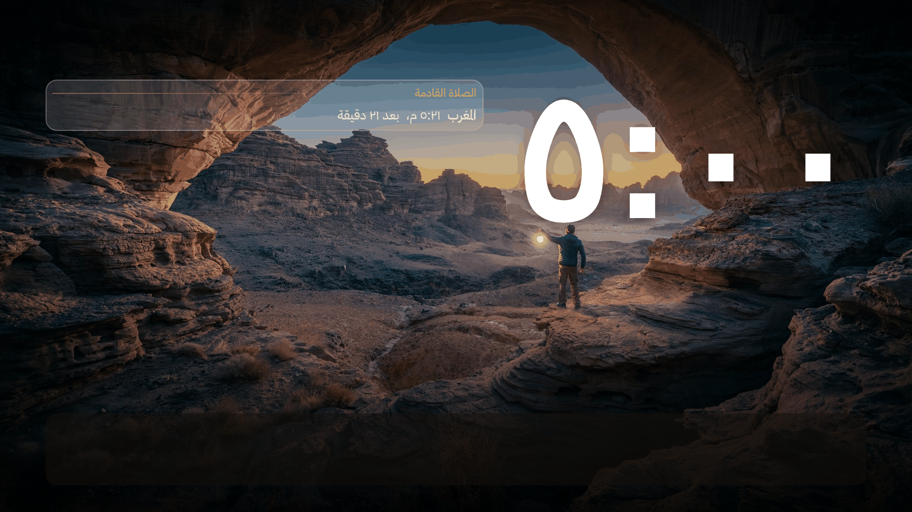 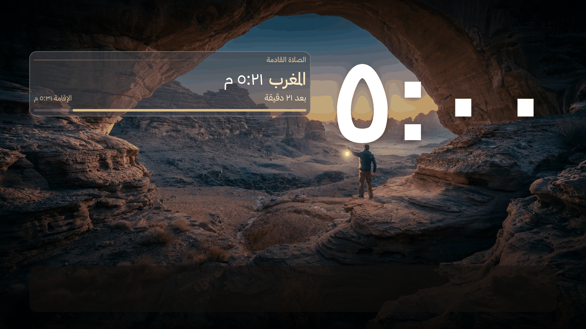

المزيد: [قبل](01-nextprayer-before-more.png)، [بعد](01-nextprayer-after-more.png)

**المراجعة**
- سطر واحد بحجم ١٤ dp («المغرب ٥:٢١ م، بعد ٢١ دقيقة») في بطاقة عرضها 461 dp: أهم معلومة في الشاشة أصغر من أسماء التطبيقات تحتها. من ٣ أمتار تُقرأ بصعوبة.
- لا تسلسل: الاسم والوقت والمتبقي بنفس الحجم تقريبًا.
- لا إقامة، مع أن المواعيد معروفة في الصفحة (`CONFIG.iqama`).
- على صورة ساطعة لا تُقرأ أبدًا (المشترك يحلها).

**بعد**
- الاسم والوقت كبيران (ضعف الحجم): «المغرب ٥:٢١ م».
- تحتهما «بعد ٢١ دقيقة»، وفي آخر السطر «الإقامة ٥:٣١ م» (لا إقامة للجمعة).
- شريط رفيع من الصلاة الماضية إلى القادمة، يمتلئ من اليمين: كم بقي يُرى بنظرة.
- بلا «·» ولا كبسولات.

**الكلفة:** 1,575 بايت (تُعاد كتابة `nextPrayerRows` و٧ قواعد). **الخطر:** البطاقة أطول (نحو ١١٠ dp بدل ٥٥)؛ ما زالت داخل صندوقها (250 dp).
الشريط يُحدَّث مع إعادة رسم الصلاة كل دقيقة كما الآن، لا مؤقت جديد.

## ٠٢ مواقيت اليوم («مربعات»)

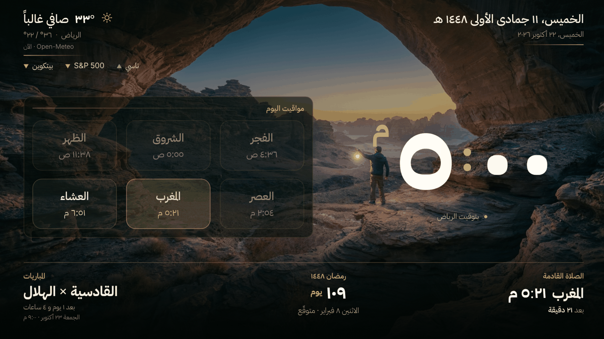 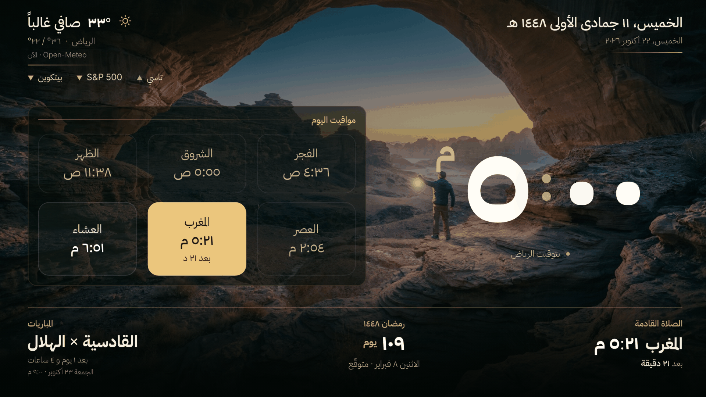

المزيد: [قبل](02-prayers-before-more.png)، [بعد](02-prayers-after-more.png)

**المراجعة**
- الصلاة القادمة مميزة بإطار ذهبي خفيف فقط: على الرئيسية بالساعة الزجاجية (مشهد الرياض) وعلى صورة ساطعة لا تكاد تُميَّز عن غيرها.
- الماضية `#8F8670` على زجاج: على الصورة الساطعة تختفي (الفجر والشروق والظهر في صورة الرئيسية الساطعة).
- الوقت أصغر من الاسم (٨٢٪)، والوقت هو المعلومة.
- لا شيء يقول كم بقي؛ على شاشة التوقف هو في الأسفل، أما في الرئيسية فلا.

**بعد**
- المربع القادم ذهبي مصمت بكتابة داكنة، وفيه «بعد ٢١ د»: أقوى شيء في البطاقة.
- الوقت سطر أقوى (١٫٠٦ من الاسم، وزن 500، أبيض)، والاسم فوقه أخف.
- الماضية بلا خلفية وبلون `#B9B09C` (تُقرأ، لكنها هادئة).
- **جرّبت صفًّا واحدًا من ستة** (مثل نموذج `work/433-design`): في بطاقة 461 dp صغّر كل الكلمات، فرجعت إلى ٣×٢. لو أراد المالك الصف الواحد
  فالأفضل في التخطيط العريض («كنبة») فقط.

**الكلفة:** 1,150 بايت. **الخطر:** قليل؛ نفس الشبكة ونفس القياس. «بعد ٢١ د» يتبع `shortHM` الموجود.

## ٠٣ الآية والحديث

 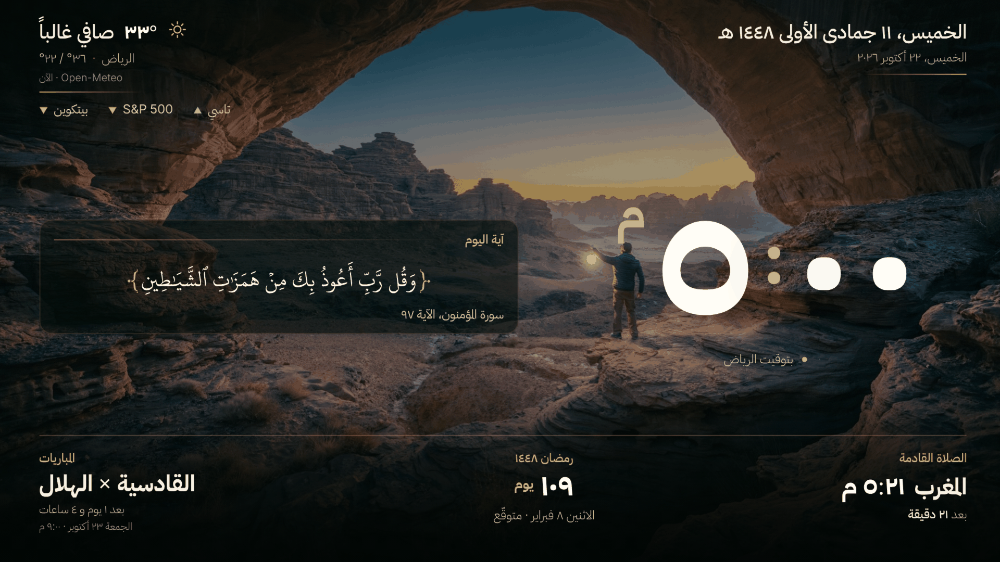

المزيد: [قبل](03-verse-before-more.png)، [بعد](03-verse-after-more.png)

**المراجعة**
- المصدر «سورة المؤمنون · ٩٧»: فاصل «·» ممنوع عندنا، والرقم وحده لا يقول إنه رقم الآية.
- الآية القصيرة ملتصقة باليمين وبقية البطاقة فارغة؛ الآية تبدو سطرًا من قائمة.
- القوسان ﴿﴾ صغيران (١٫٠٥em) بجانب خط حفص الكبير (١٫٣٢em).
- حجم الآية جيد ومقروء؛ لا تغيير فيه.

**بعد**
- الآية والمصدر في الوسط، كلوحة.
- المصدر «سورة المؤمنون، الآية ٩٧».
- القوسان بحجم الآية (١٫٥em)، ذهبيان. خط حفص ليس فيه هذان الحرفان، فيبقيان من NotoMarks.
- الحديث يأخذ نفس التوسيط.

**الكلفة:** 401 بايت (التغيير في الصفحة نفسها سيكون سطرًا في قالب `quoteOfDay` بدل الغلاف). **الخطر:** الآية الطويلة في الوسط تبقى كما هي في
القياس (`fitQuote` لا يتغير)؛ النص الطويل الموسَّط أصعب قليلًا في القراءة من المحاذاة لليمين، فإن رأى المالك ذلك يُوسَّط القصير فقط (أقل من سطرين).

## ٠٤ الأيام القادمة (الطقس)

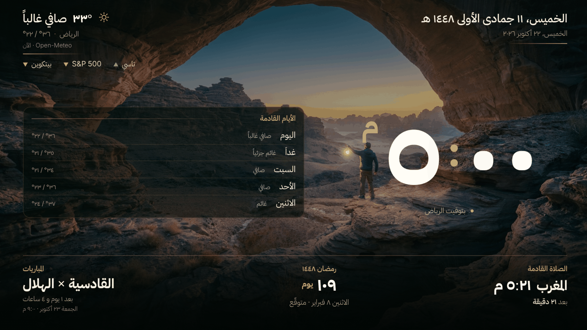 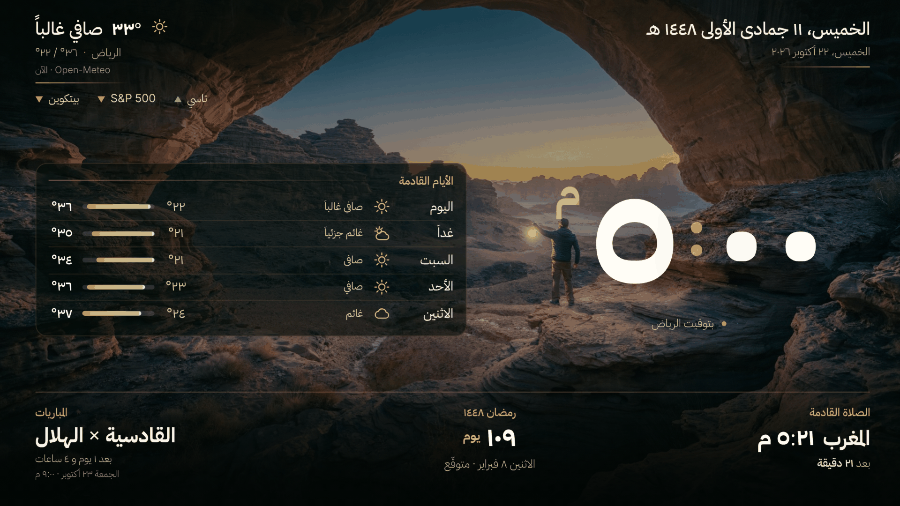

المزيد: [قبل](04-forecast-before-more.png)، [بعد](04-forecast-after-more.png)

**المراجعة**
- بلا أيقونات، مع أن «الساعات القادمة» لها أيقونات: البطاقتان من عائلة واحدة ولا تتشابهان.
- العظمى والصغرى «٣٦° / ٢٢°» بلون واحد خافت وفي أقصى اليسار، بعيدة ٧٠٠ بكسل عن اسم اليوم: العين تقفز.
- الحالة («صافي غالباً») صغيرة وخافتة.

**بعد**
- أيقونة لكل يوم (نفس رسوم الساعات القادمة).
- الصغرى خافتة، ثم شريط مدى الأسبوع، ثم العظمى بيضاء عريضة: يُرى بنظرة أي يوم أحر.
- الشريط من البارد إلى الحار من اليمين لليسار، مثل اتجاه القراءة.

**الكلفة:** 1,738 بايت (`forecastRows` جديدة و٨ قواعد). **الخطر:** متوسط: السطر صار شبكة؛ يُختبر على 960 و1280 والإنجليزية (اتجاه الشريط يُقلب في LTR).

## ٠٥ الساعات القادمة

 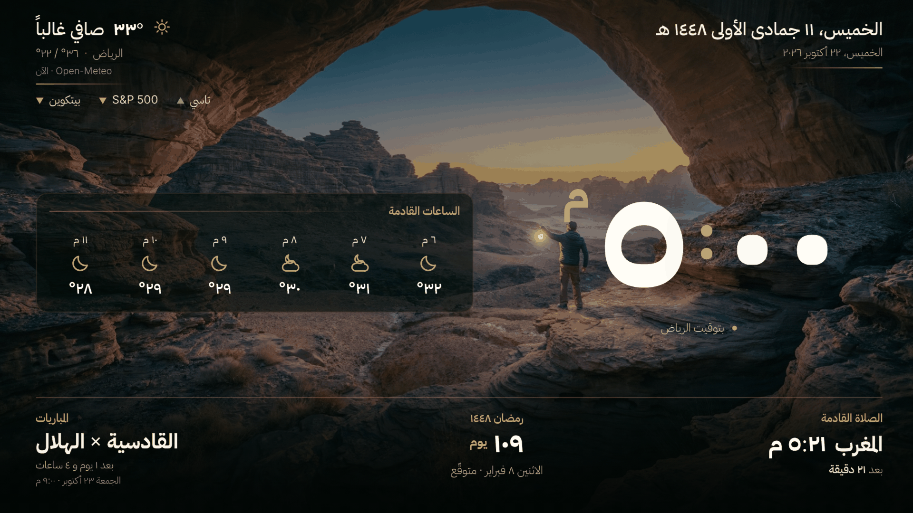

المزيد: [قبل](05-hourly-before-more.png)، [بعد](05-hourly-after-more.png)

**المراجعة**
- أفضل البطاقات اليوم: أيقونة ودرجة لكل ساعة، مرتبة.
- الساعة «٦ م» `#B9AE96` بحجم ٠٫٧٨: الأضعف قراءة.
- الدرجة بنفس وزن النص؛ هي ما يُنظر إليه.

**بعد (تغيير صغير)**
- الساعة أوضح (`#E2DACA`، ٠٫٨٤em).
- الدرجة أكبر (١٫٢em) وبوزن 500.
- الأيقونة أصغر قليلًا (١٫٧em) حتى لا تطغى على الرقم.
- المسافات على شبكة ٨ بكسل.

**الكلفة:** 227 بايت. **الخطر:** لا يُذكر.

---

# الدفعة الثانية

ملاحظة عامة: الفاصل «·» ما زال في أكثر من عشرين مكانًا في الصفحة (تاريخ المباراة، المصدر، الأسواق، المناسبة، «بتوقيت الرياض · …»). الأنظف
ثابت واحد للفاصل («، » أو مسافتان) يُبدَّل في مرة واحدة، لا بطاقة بطاقة.

وخطأ لغوي مشترك: `qty()` تكتب «١ يوم» و«٥٧ يوم» و«٢٠ يوم». الصحيح «يوم» و«٥٧ يومًا» و«١٠٩ أيام» (ما آخره ٣ إلى ١٠ جمع، ١١ إلى ٩٩ مفرد منصوب).
الإصلاح في `countdown.js` (نحو ٢٠٠ بايت) ويصلح كل «بعد … يوم» في الصفحة؛ مكان المناسبة («١٠٩ يوم») يحتاج نفس السطر.

## ٠٦ مواقيت اليوم في صف (الشكل العادي)

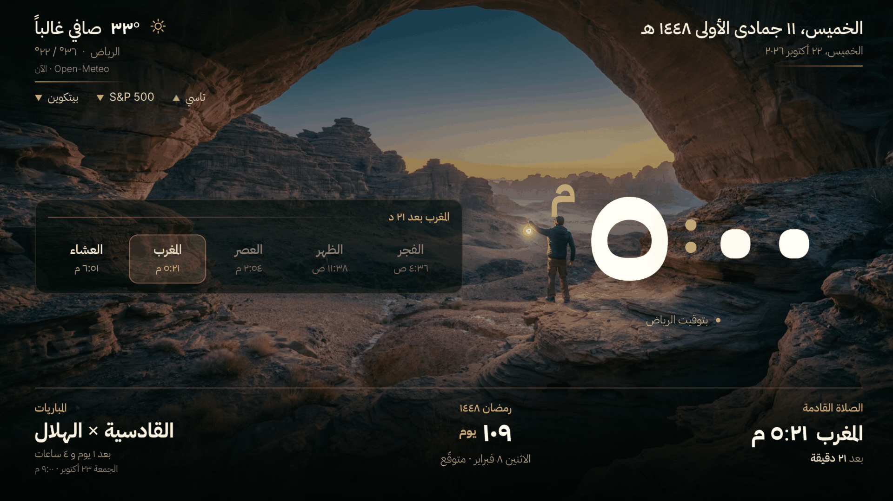 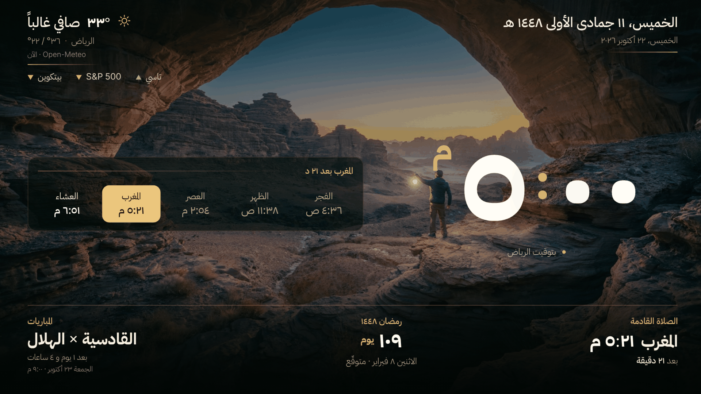

المزيد: [قبل](06-prayerrow-before-more.png)، [بعد](06-prayerrow-after-more.png)

**المراجعة:** نفس ملاحظات ٠٢ (الموافق عليها): القادمة بإطار خافت، الماضية تختفي على الزجاج، الوقت أصغر من الاسم.
**بعد:** أفكار ٠٢ هنا، لا في «مربعات» (تبقى كما بنتها جلسة التصميم): القادمة ذهبية مصمتة بكتابة داكنة، الوقت السطر الأقوى، الماضية هادئة مقروءة.
**الكلفة:** 405 بايت. **الخطر:** قليل.

## ٠٧ المباريات

 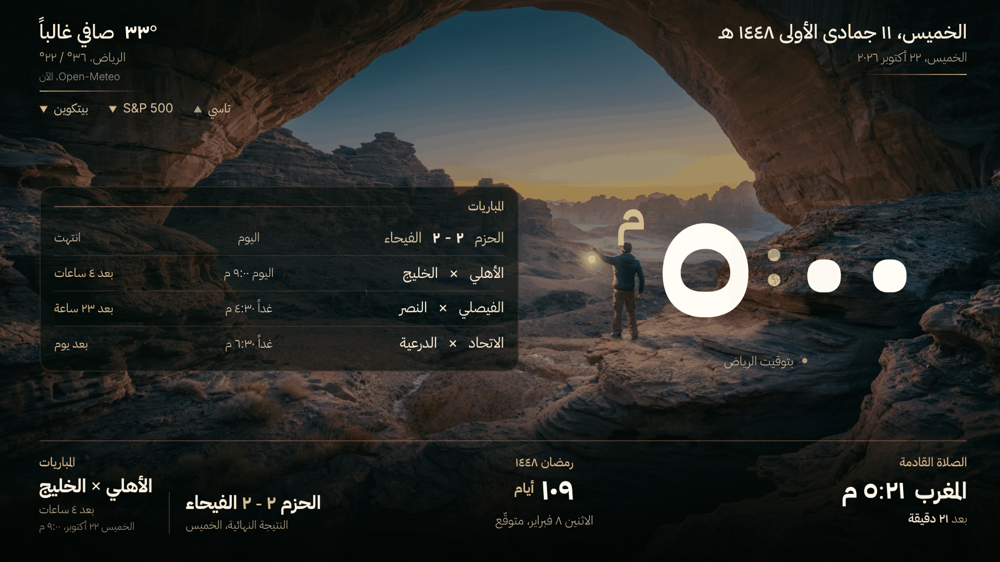

المزيد: [قبل](07-matches-before-more.png)، [بعد](07-matches-after-more.png)

**المراجعة**
- عمود التاريخ «الخميس ٢٢ أكتوبر · ٩:٠٠ م» طويل وخافت، وفيه «·»، ومعه «بعد ٤ ساعات»: نفس المعلومة مرتين.
- المباراة المنتهية بنفس وزن القادمة.
**بعد**
- التاريخ بالكلمة: «اليوم ٩:٠٠ م»، «غدًا ٤:٣٠ م»، أو اسم اليوم؛ بلا «·»، وأوضح لونًا.
- «بعد …» بالذهبي: هو ما يُنظر إليه.
- المنتهية أهدأ لونًا، والنتيجة ذهبية كما هي.
- (ملاحظة المالك) اليوم والوقت في عمود واحد في الوسط، أفقيًا ورأسيًا: كل سطر يبدأ تاريخه حيث تنتهي أعرض أسماء في البطاقة، و«بعد …» بعرض واحد. الصورة «بعد» الآن من البناء الحقيقي (`work/44-cards-build`).
**الكلفة:** 985 بايت كغلاف؛ في البناء التغيير داخل `matchWhen` (أقل). **الخطر:** متوسط: `shortenRows` يقيس الأسطر، فتُختبر الأحجام الثلاثة.

## ٠٨ مباراة فريقك القادمة

 

المزيد: [قبل](08-nextmatch-before-more.png)، [بعد](08-nextmatch-after-more.png)

**المراجعة**
- مباراة واحدة في سطر رفيع بحجم سطر القائمة: نفس مشكلة «الصلاة القادمة».
- «بعد ١ يوم» (يجب «بعد يوم»).
- على شاشة التوقف نفس المباراة في الأسفل («المباريات»): البطاقة تكرارها. الأنفع هناك أن يختار المالك غيرها؛ على الرئيسية لا تكرار.
**بعد:** الفريقان كبيران (١٫٧)، وتحتهما «غدًا ٩:٠٠ م» و«بعد يوم» بالذهبي.
**الكلفة:** 1,022 بايت. **الخطر:** قليل؛ صنف `nm1` على هذه البطاقة وحدها.

## ٠٩ الأسهم

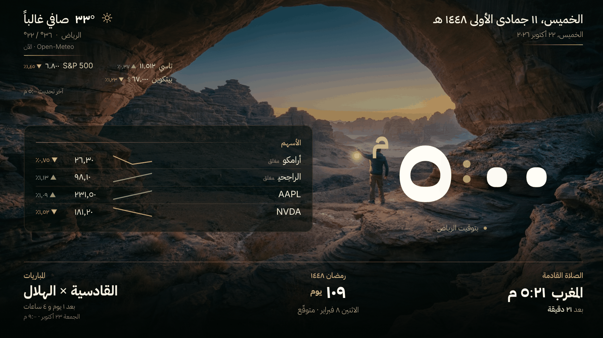 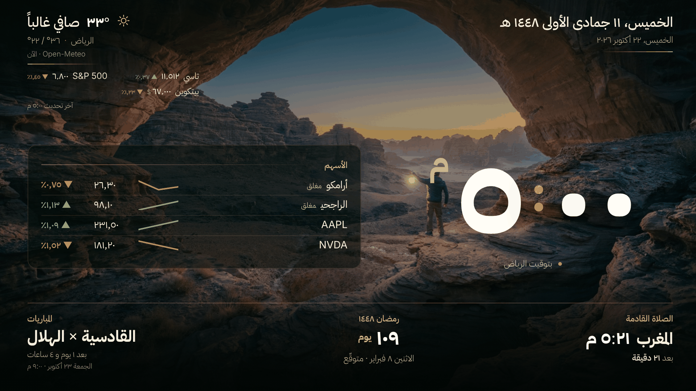

المزيد: [قبل](09-stocks-before-more.png)، [بعد](09-stocks-after-more.png)

**المراجعة:** بطاقة جيدة: الاسم، الخط، السعر، التغير. «مغلق» صغير جدًا (٠٫٦٤em) والتغير أصغر من السعر مع أنه ما يُنظر إليه.
**بعد (تغيير صغير):** التغير أكبر وأعرض، «مغلق» يُقرأ، الخط أسمك قليلًا.
**الكلفة:** 148 بايت. **الخطر:** لا يُذكر.

## ١٠ العدّ التنازلي (مكان الأسفل)

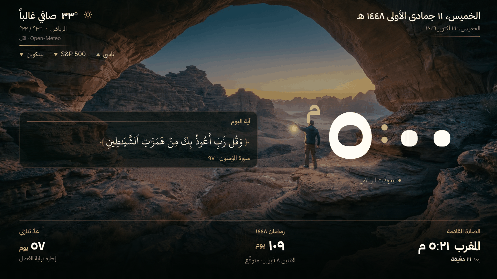 

المزيد: [قبل](10-countdown-before-more.png)، [بعد](10-countdown-after-more.png)

**المراجعة**
- العنوان «عدّ تنازلي» لا يقول شيئًا، واسم المناسبة («إجازة نهاية الفصل») صغير تحت الرقم.
- «٥٧ يوم» خطأ (يومًا).
- لا تاريخ.
**بعد:** اسم المناسبة هو العنوان، «٥٧ يومًا» (و«غدًا»، و«اليوم»)، وتحته «الجمعة ١٨ ديسمبر».
**الكلفة:** 1,080 بايت كغلاف؛ في البناء تعديل `slotText` و`qty` (نحو 300). **الخطر:** قليل؛ `qty` مستعمل في كل «بعد …»، فتُراجع اختبارات النصوص.
